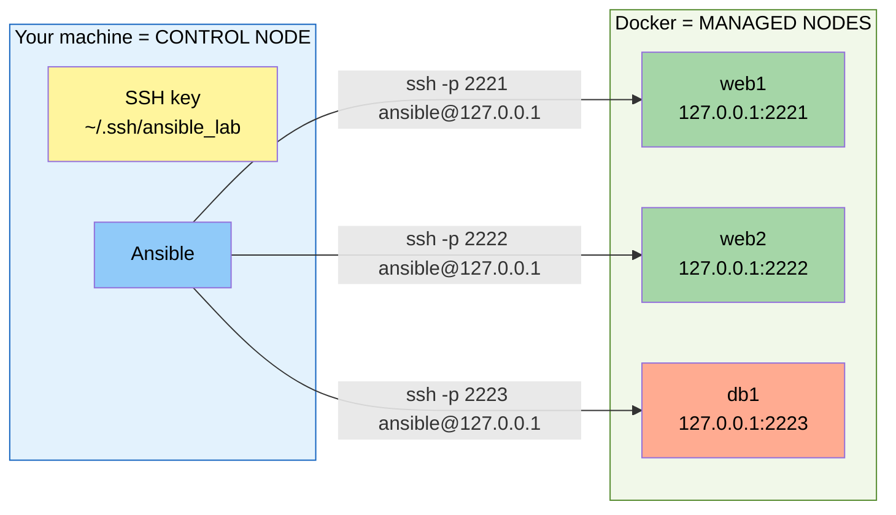
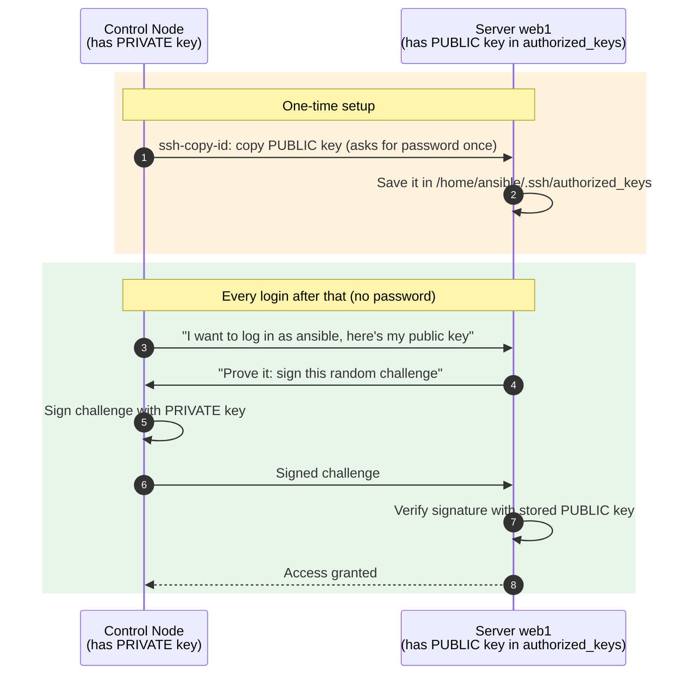

# Lab Setup and SSH Access

By the end of this block every learner has:

1. Three running lab servers: `web1`, `web2`, `db1` (Docker containers)
2. An SSH key pair for Ansible
3. Password-less SSH access to all three servers, the foundation for everything that follows

---

## 1. The lab we are building



**Why Docker containers?** They start in seconds, cost nothing, behave like small Ubuntu servers (SSH, users, sudo, apt) and can be thrown away and rebuilt anytime. Everything you learn works the same on real VMs or EC2.

**Why `127.0.0.1` with different ports?** All three containers run on your machine. Docker maps each container's SSH port 22 to a different port on your machine (2221, 2222, 2223), so we reach each "server" through its own port.

## 2. What is inside a lab server?

Open [Dockerfile](Dockerfile) and walk through it. It contains exactly what a **managed node** needs and nothing more:

| Dockerfile step | Why a managed node needs it |
|-----------------|----------------------------|
| `apt-get install openssh-server` | Ansible connects over **SSH** |
| `apt-get install python3` | Ansible **modules run with Python** on the managed node |
| `apt-get install sudo` + `/etc/sudoers.d/ansible` | Lets Ansible **become root** to install packages, etc. |
| `useradd ansible` with password `ansible123` | The account Ansible logs in as. The password is used only once, to copy our SSH key. |
| `CMD ["/usr/sbin/sshd", "-D", "-e"]` | Keeps the SSH server running in the foreground |

Notice that **Ansible is not installed in the container.** That's the agentless model in practice.

## 3. Start the lab servers

From inside the `learn-ansible` folder:

```bash
docker compose up -d --build
```

| Part | Meaning |
|------|---------|
| `up` | Create and start the containers defined in [docker-compose.yml](docker-compose.yml) |
| `-d` | Detached: run in the background |
| `--build` | Build the image from the `Dockerfile` first |

Check that all three are running:

```bash
docker compose ps
```

```text
NAME   IMAGE                     COMMAND                  SERVICE   STATUS         PORTS
db1    ansible-lab-node:latest   "/usr/sbin/sshd -D -e"   db1       Up 5 seconds   0.0.0.0:2223->22/tcp
web1   ansible-lab-node:latest   "/usr/sbin/sshd -D -e"   web1      Up 5 seconds   0.0.0.0:2221->22/tcp, 0.0.0.0:8081->80/tcp
web2   ansible-lab-node:latest   "/usr/sbin/sshd -D -e"   web2      Up 5 seconds   0.0.0.0:2222->22/tcp, 0.0.0.0:8082->80/tcp
```

## 4. How SSH access works

Ansible needs to log in to every server **without someone typing a password** each time. Two ways to authenticate:

| | Password authentication | **Key-based authentication (use this)** |
|---|---|---|
| How | Type a password for each server | Prove you own a **private key** that matches a **public key** stored on the server |
| Automation | Ansible must prompt (`--ask-pass`) and needs the `sshpass` tool | Fully automatic |
| Security | Passwords can be guessed or brute-forced | Keys are practically impossible to guess |
| Production | Usually disabled | Industry standard |

### Public key vs private key

- **Private key** (`~/.ssh/ansible_lab`) **stays on the control node.** Never share it, never commit it to Git.
- **Public key** (`~/.ssh/ansible_lab.pub`) is **copied to every server**, into `~/.ssh/authorized_keys` of the login user. It's safe to share.

Think of the public key as a **lock** you install on every server's door, and the private key as the **only key** that opens that lock.



## 5. Set up SSH key access (step by step)

### Step 1: Generate a dedicated key pair for Ansible

```bash
ssh-keygen -t ed25519 -f ~/.ssh/ansible_lab -C "ansible-lab" -N ""
```

| Option | Meaning |
|--------|---------|
| `-t ed25519` | Key type. Ed25519 is modern, fast and secure (RSA 4096 also works) |
| `-f ~/.ssh/ansible_lab` | File name. Creates `ansible_lab` (private) and `ansible_lab.pub` (public) |
| `-C "ansible-lab"` | A comment/label to identify the key |
| `-N ""` | Empty passphrase. Fine for a lab; in production use a passphrase with `ssh-agent` |

Check the files:

```bash
ls -l ~/.ssh/ansible_lab*
```

```text
-rw------- 1 user user 399 Oct  9 10:00 /home/user/.ssh/ansible_lab        <- private: only you can read
-rw-r--r-- 1 user user  93 Oct  9 10:00 /home/user/.ssh/ansible_lab.pub    <- public: safe to share
```

### Step 2: Copy the public key to each server

```bash
ssh-copy-id -i ~/.ssh/ansible_lab.pub -o StrictHostKeyChecking=accept-new -p 2221 ansible@127.0.0.1
```

Enter the password **`ansible123`** when prompted. Expected output:

```text
Number of key(s) added: 1

Now try logging into the machine, with:   "ssh -p 2221 -o 'StrictHostKeyChecking=accept-new' 'ansible@127.0.0.1'"
and check to make sure that only the key(s) you wanted were added.
```

Repeat for the other two servers, or do all three in one loop:

```bash
for port in 2221 2222 2223; do
  ssh-copy-id -i ~/.ssh/ansible_lab.pub -o StrictHostKeyChecking=accept-new -p $port ansible@127.0.0.1
done
```

| Option | Meaning |
|--------|---------|
| `-i ~/.ssh/ansible_lab.pub` | Which public key to copy |
| `-o StrictHostKeyChecking=accept-new` | Automatically trust a server we've never seen before (and save it in `~/.ssh/known_hosts`) |
| `-p 2221` | SSH port (container web1) |
| `ansible@127.0.0.1` | Login user @ server address |

> **What does `ssh-copy-id` actually do?** It logs in with the password and appends your public key to `/home/ansible/.ssh/authorized_keys`, fixing permissions on the way. The manual equivalent:
> ```bash
> cat ~/.ssh/ansible_lab.pub | ssh -p 2221 ansible@127.0.0.1 \
>   "mkdir -p ~/.ssh && chmod 700 ~/.ssh && cat >> ~/.ssh/authorized_keys && chmod 600 ~/.ssh/authorized_keys"
> ```

### Step 3: Test password-less login

```bash
ssh -i ~/.ssh/ansible_lab -p 2221 ansible@127.0.0.1 hostname
ssh -i ~/.ssh/ansible_lab -p 2222 ansible@127.0.0.1 hostname
ssh -i ~/.ssh/ansible_lab -p 2223 ansible@127.0.0.1 hostname
```

```text
web1
web2
db1
```

No password prompt means it works.

### Step 4: Test sudo (Ansible's `become`)

```bash
ssh -i ~/.ssh/ansible_lab -p 2221 ansible@127.0.0.1 "sudo whoami"
```

```text
root
```

The lab user has **passwordless sudo** (`ansible ALL=(ALL) NOPASSWD:ALL`). That's what lets Ansible install packages without prompting.

> **Golden rule:** if plain `ssh` to a server does not work, Ansible will not work either. Always debug SSH first.

## 6. Doing the same on a real server (production checklist)

On real servers you usually create a dedicated automation user once (by hand, via cloud-init, or in your VM image). On **each managed server**, as an admin:

```bash
# 1. Create the user
sudo useradd -m -s /bin/bash ansible

# 2. Give it sudo rights without a password prompt
echo "ansible ALL=(ALL) NOPASSWD:ALL" | sudo tee /etc/sudoers.d/ansible
sudo chmod 0440 /etc/sudoers.d/ansible
sudo visudo -cf /etc/sudoers.d/ansible      # validate syntax -> "parsed OK"

# 3. Install your public key
sudo mkdir -p /home/ansible/.ssh
echo "ssh-ed25519 AAAA...your-public-key... ansible-lab" | sudo tee /home/ansible/.ssh/authorized_keys
sudo chown -R ansible:ansible /home/ansible/.ssh
sudo chmod 700 /home/ansible/.ssh
sudo chmod 600 /home/ansible/.ssh/authorized_keys
```

## 8. Resetting the lab

There are two kinds of reset. They need different follow-up steps.

### Reset 1: fresh containers (most common)

```bash
docker compose down              # stop and delete the containers
docker compose up -d             # new containers from the same image
```

Everything change on the servers is gone, **including the copied SSH key**. Ansible now fails with:

```text
web1 | UNREACHABLE! =>
    msg: '... ansible@127.0.0.1: Permission denied (publickey,password).'
```

Fix it by repeating Step 2:

```bash
for port in 2221 2222 2223; do
  ssh-copy-id -i ~/.ssh/ansible_lab.pub -o StrictHostKeyChecking=accept-new -p $port ansible@127.0.0.1
done
```

The SSH **host keys don't change** here: they're created when the image is *built* (`ssh-keygen -A` in the Dockerfile), and every container made from that image reuses them.

### Reset 2: rebuilt image

```bash
docker compose down
docker compose build --no-cache  # or any rebuild after editing the Dockerfile
docker compose up -d
```

A rebuilt image has **new host keys**, so your `~/.ssh/known_hosts` no longer matches and `ssh-copy-id` stops with:

```text
WARNING: REMOTE HOST IDENTIFICATION HAS CHANGED!
```

Remove the old entries first, then repeat Step 2:

```bash
for port in 2221 2222 2223; do ssh-keygen -R "[127.0.0.1]:$port"; done
```

Ansible itself doesn't show this warning, because our `ansible.cfg` sets `host_key_checking = False` for the lab (block 05). It's plain `ssh` and `ssh-copy-id` that refuse to connect.

## Checkpoint

All three commands print the hostname without asking for a password:

```bash
for port in 2221 2222 2223; do ssh -i ~/.ssh/ansible_lab -p $port ansible@127.0.0.1 hostname; done
```

---